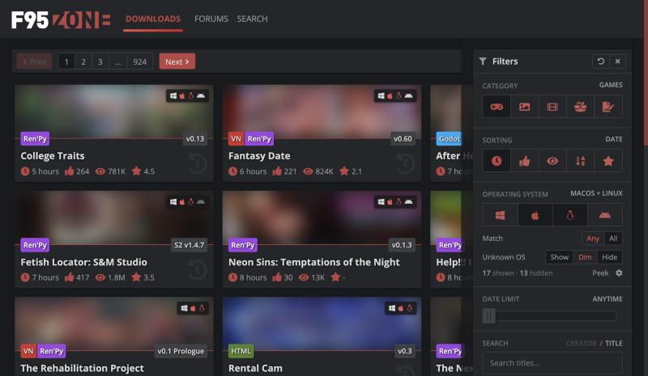
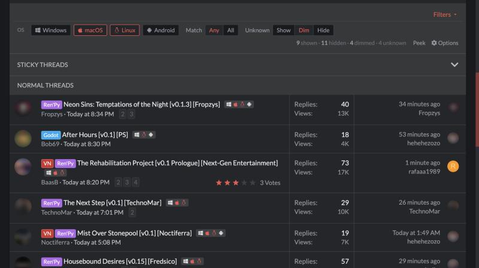

# F95Zone OS Filter

A Tampermonkey userscript that filters F95Zone game listings by operating system: **Windows, macOS, Linux and Android**.

It works on Latest Updates, the game forums, search results, and the Watched / What's new / Tags lists. The controls are built into the site's own UI:

- **Latest Updates:** an "Operating system" section in the site's Filters drawer, plus a toolbar button with the hidden count.
- **Forums and search:** a row in the forum's filter bar above the thread list.

Each game gets a small tag with the OS logos it supports.

Cover images and avatars are blurred in these screenshots.

## Install

1. Install [Tampermonkey](https://www.tampermonkey.net/) in your browser.
2. Open **[f95zone-os-filter.user.js](https://github.com/neokatin/f95zone-os-filter/raw/main/f95zone-os-filter.user.js)**. Tampermonkey will offer to install it.
3. Visit F95Zone. Tampermonkey checks this repository for updates automatically.

## How OS support is decided

Nothing is guessed. For each game the script reads the first post of its thread and uses only:

1. **The thread's `OS:` line**, which is what the uploader states. These show as solid logos.
2. **Download labels** such as `Win/Linux:` or `Mac:`, which mean a build for that OS is linked. These show as faded logos.

The game engine (Ren'Py, Unity, …) is never used to infer support. Lines like "Mac (coming soon)" and JoiPlay (an Android emulator) don't count. If a thread doesn't say, the game is marked **OS ?**, and you choose whether unknown games are shown, dimmed or hidden.

## Features

- Pick any combination of OSes, and match **Any** or **All** of them
- Hide or dim games that don't match
- Show, dim or hide games whose OS is unknown
- Hidden count, plus **Peek** to temporarily reveal hidden games
- Works with pages that update in place (Latest Updates paging, new forum rows)
- Settings are saved; OS info is cached for 7 days and re-checked when a game's version changes
- Lightweight: each game is checked through the forum's thread preview (about 1/20th the size of the thread page), two at a time with a delay, and checking pauses if the site rate-limits
- Options: turn off tags, turn off automatic checking, count "PC" as Windows, choose which pages it runs on, clear the cache
- Keyboard shortcut: **Alt+O**

## Notes

- Some threads are only fully visible when you're logged in. The script uses your normal browser session and never sends data anywhere except F95Zone.
- If F95Zone changes its page layout, the selectors are listed near the top of the script in `ADAPTERS`.

## License

[MIT](LICENSE)
